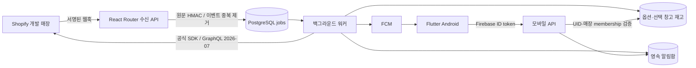

# 설계 및 운영

## 데이터 흐름

Shopify 서버를 별도로 중복 구축하지 않았습니다. 공식 React Router 앱이 설치 인증·웹 설정·모바일 API를 담당하며 같은 코드베이스의 워커가 큐를 처리합니다. ORM 대신 `pg`와 명시적 SQL을 사용해 큐·이벤트 수신·알림 생성의 트랜잭션 경계를 공유합니다. 템플릿의 SQLite/Prisma 경로는 사용하지 않습니다.

## 인증 및 격리

- Shopify 설치는 공식 `@shopify/shopify-app-react-router` 인증 흐름입니다. `expiringOfflineAccessTokens`를 켜고 SDK에 토큰 갱신을 맡깁니다.
- 공식 Session 직렬화를 이용하되 전체 저장값을 AES-256-GCM으로 암호화합니다. access token과 refresh token 모두 평문으로 저장되지 않습니다. 키는 서버 환경변수의 32바이트 값입니다. 키 회전 시 기존 ciphertext를 복호화해 새 키로 다시 암호화하거나 재설치를 요구해야 합니다.
- Shopify 세션의 온라인 사용자 개인정보는 의도적으로 저장하지 않습니다. 모바일 사용자의 로그인 계정은 Firebase Authentication이 관리합니다.
- 모바일 Firebase ID token은 매 요청 서버에서 서명·프로젝트·만료·계정 폐기 여부·이메일 인증을 확인합니다. 모바일의 서비스 토큰·매장 연결값·FCM 토큰은 `flutter_secure_storage`에 보관합니다.
- 일회용 코드는 192비트 난수, DB에는 SHA-256 해시만 저장하고 UID·매장·설치 세대에 묶습니다. 만료 5분, 원자적 소비, 재사용 거부입니다.
- 모든 모바일 DB 작업은 `uid + shop + active` membership을 검사합니다. 요청 본문의 상품 식별자만으로 다른 매장을 조회하지 않습니다. API 요청에 임의 Shopify Admin 토큰을 받지 않습니다.
- Shopify 설치 해제는 매장 비활성화, 세대 증가, 세션·membership·연결 코드·기기 삭제, queued/running 작업 취소를 수행합니다.
- 공개 앱 컴플라이언스 웹훅의 원문 서명을 검증합니다. 고객·주문 데이터를 수집하지 않아 customer 요청은 해당 데이터 없음으로 처리하며, `shop/redact`는 매장 데이터와 감사·수신 기록을 삭제합니다. 출시 전 실제 웹훅·개인정보 정책 검토가 필요합니다.

## 재고와 알림

키는 `shop + inventory item + location`이며 상품·옵션 GID를 함께 저장합니다. 한 매장에서 선택한 창고 하나만 조회합니다. 미추적 재고는 `null`이고 0과 구분합니다. 옵션별 기준·활성 여부를 지원합니다. 매장 기본 기준은 5입니다.

`5→4`에서 한 번, `4→3→2`에서는 반복 없이, `7→4` 재하락 시 다시, 양수에서 0 이하가 되면 별도 품절 이벤트를 기록합니다. 최초 동기화는 개별 푸시 대신 부족 항목 요약 하나를 만듭니다. 알림함에는 발생 당시 수량을 고정하고 조회할 때 현재 재고를 함께 보여 줍니다.

웹훅 수량은 최종 상태로 사용하지 않습니다. 수신은 원문 HMAC·중복 receipt·영속 작업 enqueue 후 응답합니다. 워커가 선택 창고를 GraphQL로 페이지네이션하여 조회합니다. 매장 행 잠금으로 동기화 작업을 직렬화하고 source timestamp가 뒤인 상태를 과거 응답으로 덮어쓰지 않습니다. 전체 페이지가 성공해야 누락 상품 제거와 sync 완료 시각이 커밋됩니다. 실패하면 기존 상태를 보존합니다.

큐는 `FOR UPDATE SKIP LOCKED`, lease token, 15분 임대, 지수 백오프+jitter, 최대 8회 후 failed 기록을 사용합니다. 동기화는 15분마다 재예약하고 워커 scheduler는 1분마다 확인합니다. Shopify API cost 예산을 보고 잠시 기다리며 throttle/네트워크 오류는 큐에서 재시도합니다.

**운영 한계:** 현재 동기화는 매장별 전체 재고 스캔으로 정확성을 우선합니다. 대형 카탈로그의 처리시간·DB 잠금·15분 임대에 대한 부하 검증은 미실시입니다. 출시 전에 웹훅 대상 item 단위 갱신과 Bulk API 초기 동기화로 확장해야 합니다. 첫 목표는 소규모 개발 매장입니다. PGlite 테스트는 PostgreSQL 다중 워커 경합 테스트를 대신하지 않습니다.

방해금지 시간은 IANA 시간대와 현지 시각으로 계산하여 DST·자정 교차를 처리합니다. 같은 시작·종료 시각은 방해금지 없음입니다. 해당 시간에는 알림함에 기록하고 푸시를 미룹니다. 종료 후 digest 작업이 최신 재고를 다시 조회한 후 현재 부족 상태를 요약합니다. 회복된 항목은 요약 대상에서 제외합니다.

FCM 수락과 기기 수신은 다릅니다. 무효 기기 토큰은 삭제합니다. 일상적인 웹훅 중복은 alert/job 유일성으로 제거하고 Android notification tag를 alert ID로 설정합니다. **FCM 송신 직후 프로세스가 죽는 경우 등 분산 시스템의 모호한 응답에서는 정확히 한 번 전달을 보장하지 않습니다.** 재시도는 at-least-once이며 알림 tag·모바일 deep-link ID 중복 검사로 중복 영향을 줄입니다. 푸시 권한이 없어도 알림함은 독립 유지됩니다.

## 배포 준비

실제 배포는 수행하지 않았습니다. 승인 후 다음 두 프로세스를 같은 코드·환경 설정으로 배포합니다.

- 웹: `npm run start` (빌드 후, 기본 3000 포트)
- 워커: `npx tsx server/worker.ts` (환경변수는 배포 플랫폼에서 주입)
- 릴리스 작업: `npx tsx server/migrate.ts`

필수 환경: `DATABASE_URL`, `SHOPIFY_API_KEY`, `SHOPIFY_API_SECRET`, `SHOPIFY_APP_URL`, `SCOPES`, `TOKEN_ENCRYPTION_KEY`, `FIREBASE_PROJECT_ID`, ADC 또는 `GOOGLE_APPLICATION_CREDENTIALS`.

외부 HTTPS 종료, 접근 로그에서 Authorization·본문 제거, 요청 크기 제한(웹훅 2MB 이하), 적절한 rate limit, DB 백업·복구 훈련, 큐 failed/연결 오류 모니터링을 호스팅 환경에서 구성합니다. 현재 SQL v1은 새 DB를 만드는 방식이며 향후 스키마 변경은 별도 버전 migration으로 추가해야 합니다. 이미 실행한 v1을 수동 수정하여 운영 DB를 변경하면 안 됩니다.

failed 작업은 원인을 해결한 뒤 운영자가 특정 ID만 queued로 되돌립니다. 설치 해제 매장 작업은 재개하지 않습니다. 작업 오류에는 raw 응답·토큰을 기록하지 않습니다. 완료 큐/웹훅 수신 이력은 7일, 만료 코드 이력은 1일 후 정리합니다. 알림 보존 정책은 출시 전에 확정해야 합니다.

## 후속 단계의 경계

- Phase 2: 명시적 옵션 선택·확인, 20%/2시간 프리셋, 네이티브 자동 할인. 가격 덮어쓰기 금지. 할인 생성 전 idempotency 원장 커밋, 모호한 생성 응답은 원격 조회로 조정하고 무조건 재생성하지 않기. 앱 소유 할인만 종료. 본 버전에는 실행 경로 없음.
- Phase 3: Theme App Extension app block과 앱 소유 metafield. 할인 생성과 배너 갱신은 별개이며 부분 성공 원장·재시도 필요. 만료·오래된 상태에서는 숨김. 본 버전에는 확장 없음.
- Phase 4: Shopify App Pricing 계정 지원 여부·구독 검증·Play 국가별 정책 확인 후 도입. $19.99는 가설. 모바일 외부 결제 버튼·RevenueCat·Play 결제는 없음. 만료 후 조회·기존 할인 종료는 허용하고 새 실행만 차단하는 정책을 후속 구현. 현재 entitlement 함수는 테스트용 준비 로직이며 실제 구독 검증 완료를 의미하지 않음.
